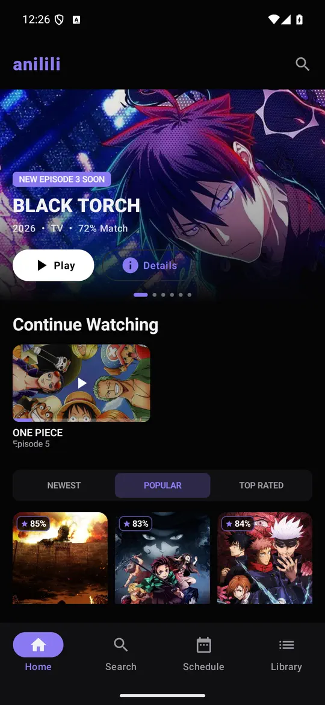
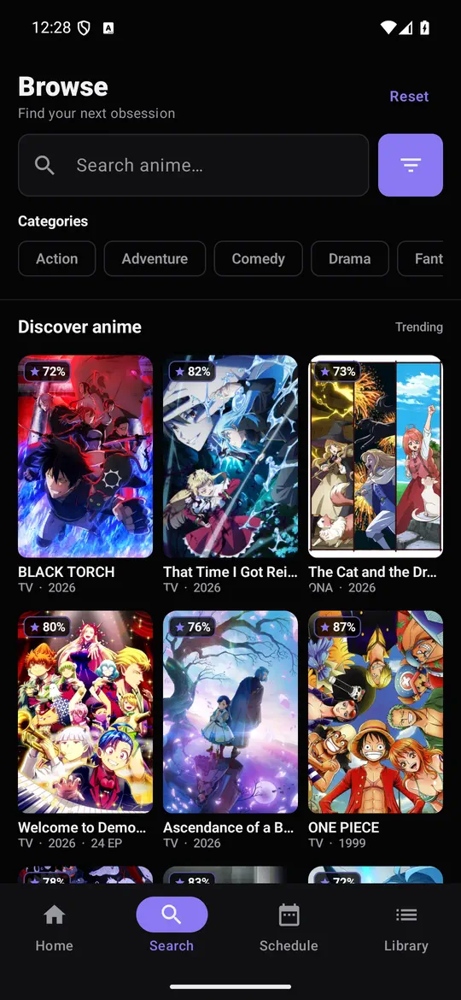
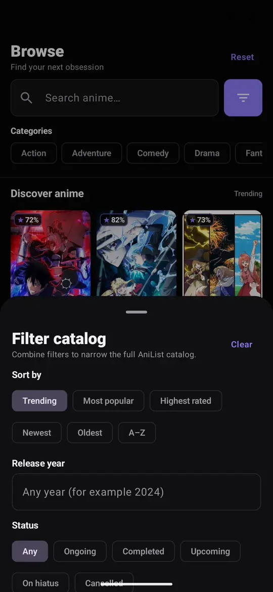
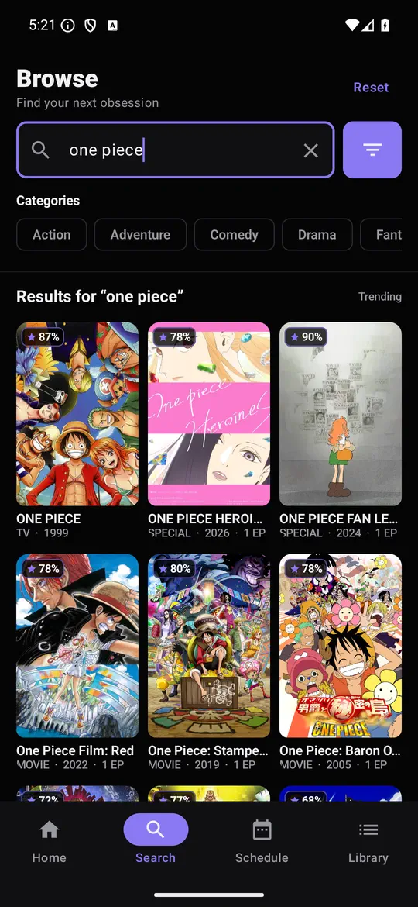
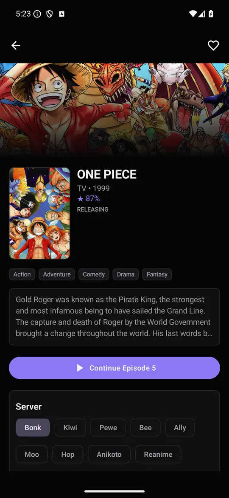
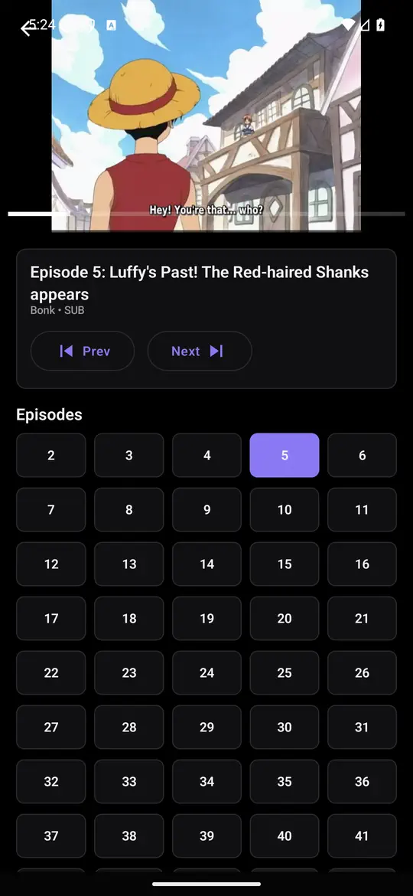

# Aniken TV · AniLiberty edition

This branch keeps the open-source Aniken/Anilili Android TV user interface and
playback engine (Kotlin, Jetpack Compose, Media3), but replaces the former
multi-service backend with **AniLiberty API v1 only**.

Catalog, release details, schedules, episode UUIDs, HLS streams, profile,
collections, favourites, and watch progress all come from AniLiberty. The old
AniList, Miruro, Anivexa, Jikan, pipe, and Cloudflare scraping clients have
been removed. Media3/ExoPlayer plays the official HLS sources natively.

> Experimental open-source client. Not an official AniLiberty app.
> The UI is based on Aniken/Anilili. Distribute as a sideloaded APK.

## Screenshots

<p align="center">
  <a href="showcase/mobile/01-home.webp"></a>
  <a href="showcase/mobile/02-browse.webp"></a>
  <a href="showcase/mobile/03-filters.webp"></a>
</p>
<p align="center">
  <a href="showcase/mobile/04-search.webp"></a>
  <a href="showcase/mobile/05-anime-details.webp"></a>
  <a href="showcase/mobile/06-player.webp"></a>
</p>

## Features

- Home feeds for trending, popular, and recently released anime.
- Browse and search with AniLiberty-supported genre, year, status, format, and sort filters.
- Anime details and episode lists supplied by AniLiberty.
- Native HLS playback at the resolutions provided by AniLiberty, intro/outro skip, and auto advance.
- TV sign-in using an OTP displayed on the TV and accepted at
  `https://anilibria.top/app/auth/otp/linkDevice` on a signed-in device.
- Watching, planning, paused, completed, and dropped collections from the account.
- Watch history, continue-watching resume positions, local watchlist,
  and optional AniLiberty episode timecode sync.
- Adaptive Compose UI for phone and TV-style layouts.

The former local library used AniList IDs; the AniLiberty library has its **own
separate storage** to avoid mixing unrelated titles that have matching numeric IDs.
The old local library is not erased.

AniLiberty's schedule API does not supply a precise airtime; the app never
guesses a timestamp for notifications. Filters not supported by the service
cannot be passed through as old-provider-specific parameters.

## Project Structure

| Path | Purpose |
| --- | --- |
| `app/src/main/java/com/miruronative/data` | Presentation models, repository and local library |
| `app/src/main/java/com/miruronative/data/remote` | AniLiberty API v1 client |
| `app/src/main/java/com/miruronative/ui` | Compose screens and player UI |
| `showcase/mobile` | Six optimized 540×1170 WebP screenshots |

## Build

Requirements:

- JDK 17
- Android Studio or Android SDK API 36 with build-tools 35.0.1
- Gradle 8.13 if building from the command line without a generated wrapper

Android Studio:

1. Open this repository folder.
2. Let Gradle sync.
3. Run the app on a device/emulator or use Build > Build APK(s).

Command line:

```bash
gradle wrapper
./gradlew assembleDebug
```

On Windows, use:

```powershell
gradlew.bat assembleDebug
```

The debug APK is generated at `app/build/outputs/apk/debug/app-debug.apk`.

## Notes

- `local.properties`, build output, IDE files, Graphify output, temporary folders, and old API
  bundles are intentionally ignored.
- The showcase folder is intentionally limited to the six mobile screenshots shown above.
